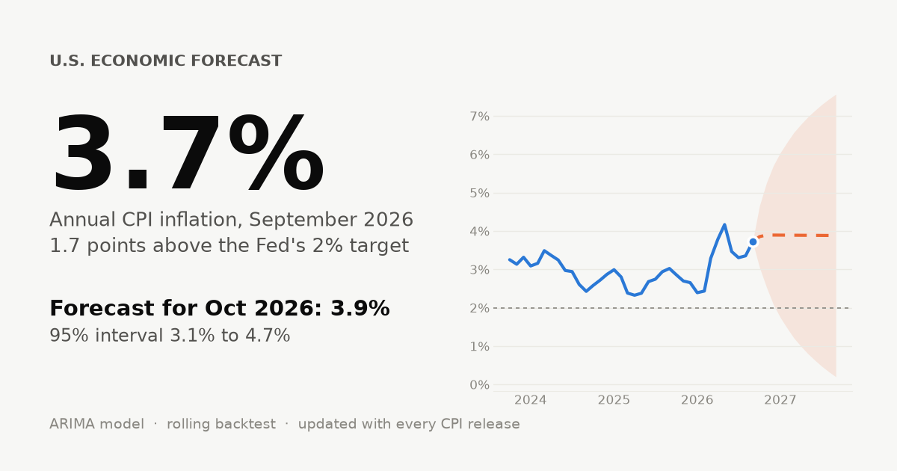
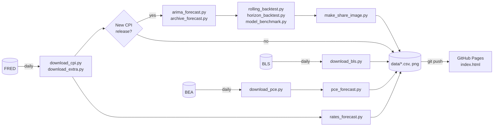

# U.S. Economic Forecast

[](https://github.com/ppc1004/us_economic_forecast/actions/workflows/update-data.yml)
[](https://github.com/ppc1004/us_economic_forecast/actions/workflows/tests.yml)

A self-updating dashboard of U.S. prices and interest rates. It tracks **CPI** and **PCE** inflation across more than 200 categories with their weights, the **Fed funds rate** and **2-, 10- and 30-year Treasury yields**, forecasts each 12 months ahead with ARIMA models, and publishes the models' track record: backtests, a four-model benchmark with significance tests, accuracy by horizon, interval calibration and a live archive of every CPI forecast it has made.

**Live site: [ppc1004.github.io/us_economic_forecast](https://ppc1004.github.io/us_economic_forecast/)**



## What's on the site

| Section | Contents |
|---|---|
| **Dashboard** | CPI, core CPI, PCE, core PCE, Fed funds and 10-year yield at a glance, forecasts, yield curve, CPI basket treemap |
| **Key findings** | Conclusions from the out-of-sample tests, recomputed automatically with every data update |
| **CPI forecast / Track record** | 12-month forecast with 95% intervals; rolling backtest, four-model competition with Diebold-Mariano tests, accuracy for 1–12 month horizons, interval coverage, live forecast archive |
| **What's driving it** | Inflation and contribution (weight × change) by the eight CPI spending groups, stacked over five years; core, food, energy and shelter |
| **Everyday prices** | Treemap of ~160 CPI categories sized by BLS relative importance and coloured by 12-month change, drill-down from groups to items (e.g. Food → Food at home → Eggs), history since 1980, biggest movers; 24 BLS average shelf prices |
| **History** | CPI inflation since 1948 with major episodes annotated |
| **PCE forecast / PCE categories** | PCE and core PCE with 12-month forecasts and backtest, CPI vs PCE since 1980, why their weights differ; treemap of 80+ PCE categories weighted by spending share |
| **Treasury yields / Fed policy** | Fed funds, 2-, 10- and 30-year forecasts with backtests vs "no change", yield curve, 10y–2y spread, mortgage rates, real (TIPS) yields; Fed funds vs inflation |
| **Your money / Expectations** | Purchasing-power calculator, wages vs inflation; model vs market breakeven inflation |

## How it works



A GitHub Actions job runs every day. It refreshes every series, re-runs the CPI models only when BLS has published a new CPI figure, the PCE models when BEA publishes new PCE data, and the rate models on every run (or everything when the workflow is started by hand). The website is a single dependency-free HTML file that reads the CSVs and draws every chart as inline SVG.

## Method

- **Data.** CPI-U, all items, seasonally adjusted (`CPIAUCSL`). Inflation is the 12-month percent change. BLS did not publish October 2025 CPI because of the federal government shutdown; that month is filled by linear interpolation so every year-over-year rate compares the same calendar month (`src/data_utils.py`).
- **Model.** ARIMA(1, 0, 2) on year-over-year inflation, chosen from nine candidate orders by out-of-sample error rather than in-sample fit.
- **Evaluation.**
  - *Rolling-origin backtest*: over the last 24 months the model is re-fit on data available at the time and forecasts one month ahead, compared with a naive "no change" benchmark (MAE, RMSE, per-month errors).
  - *Model competition*: over 48 months, ARIMA is compared with naive, ARIMAX (plus last month's energy and core inflation) and gradient-boosted trees (scikit-learn). Differences are tested with the Diebold-Mariano test, using the Harvey-Leybourne-Newbold small-sample correction.
  - *Horizon backtest*: 48 forecast origins, each scored at 1–12 months ahead, with the share of outcomes that fell inside the 95% interval.
  - *Live archive*: each published forecast is stored with its data vintage and scored when the actual CPI print arrives.
- **CPI categories and weights.** About 160 CPI-U categories (U.S. city average, not seasonally adjusted) from the BLS time-series files, organised in the BLS hierarchy. Weights are BLS relative importance, December 2025 (`data/cpi_weights.csv`). Contribution to inflation ≈ weight × 12-month change.
- **PCE.** PCE and core PCE price indexes and 80+ categories from BEA NIPA tables 2.4.4U (prices) and 2.4.5U (spending); weights are each category's share of nominal spending in the latest month. ARIMA order chosen by AIC; 48-origin horizon backtest.
- **Interest rates.** Monthly averages of the Fed funds rate and Treasury yields since 1990, ARIMA(p, 1, q) with p, q chosen by AIC, 12-month forecasts with 95% intervals, backtested against "no change" over 48 origins. The 30-year model uses only data after the 2002–2006 gap in issuance.
- **Limitations.** Univariate models see only each series' own past, not energy prices, wages or policy, and tend to lag turning points. Interest rates are close to a random walk.

## Repository layout

```
src/
  data_utils.py          shared CPI loading and YoY calculation
  download_cpi.py        headline CPI from FRED
  download_extra.py      components, wages, Fed funds, Treasury yields, expectations (FRED)
  download_bls.py        ~160 CPI categories and 24 average prices (BLS flat files)
  download_pce.py        PCE prices and spending by category (BEA NIPA)
  arima_forecast.py      12-month forecast
  archive_forecast.py    permanent record of every forecast
  rolling_backtest.py    one-step-ahead backtest vs naive
  horizon_backtest.py    1–12 month accuracy and interval coverage
  model_benchmark.py     naive vs ARIMA vs ARIMAX vs gradient boosting, Diebold-Mariano tests
  pce_forecast.py        PCE and core PCE forecasts and horizon backtest
  rates_forecast.py      Fed funds, 2/10/30-year Treasury forecasts and backtest
  make_share_image.py    social preview card
data/                    generated CSVs and the preview image
tests/                   pytest suite (no network access needed)
index.html               the website
```

## Run locally

```bash
git clone https://github.com/ppc1004/us_economic_forecast.git
cd us_economic_forecast
pip install -r requirements.txt

python src/download_cpi.py && python src/download_extra.py
python src/download_bls.py && python src/download_pce.py
python src/arima_forecast.py && python src/archive_forecast.py
python src/rolling_backtest.py && python src/horizon_backtest.py && python src/model_benchmark.py
python src/pce_forecast.py && python src/rates_forecast.py
python src/make_share_image.py

python -m http.server 8000   # then open http://localhost:8000
pip install pytest ruff
python -m pytest -q          # tests
ruff check . && ruff format --check .   # lint and formatting (config in pyproject.toml)
```

## Key results

Conclusions are recomputed with every data update and published on the [Key findings](https://ppc1004.github.io/us_economic_forecast/#findings) page. With data through August 2026:

- Month-to-month inflation is highly persistent, so a "no change" forecast is a tough benchmark one month ahead; ARIMA's edge over it widens at longer horizons (about 4% lower error at 1 month, about 14% at 12 months, over 48 forecast origins).
- The model's 95% intervals contained the actual value about 96% of the time across horizons, close to their stated coverage.
- Whether extra predictors or machine learning help, and whether any difference is statistically significant, is reported on the site with Diebold-Mariano tests.

## Engineering

- Fully automated: a daily GitHub Actions job fetches data, retrains, backtests, archives the forecast, redraws the preview image and redeploys the site.
- Tested and linted in CI (pytest, ruff); tests use synthetic data and never touch the network.
- Type-annotated Python; shared data preparation in one module.
- No build step and no JavaScript dependencies: the site is one static HTML file with hand-written, responsive SVG charts, light and dark themes.

## Maintenance

`data/cpi_release_schedule.csv` holds the BLS CPI release calendar used for the "next release" date. Update it once a year from [bls.gov/schedule/news_release/cpi.htm](https://www.bls.gov/schedule/news_release/cpi.htm).

`data/cpi_weights.csv` holds the CPI category tree and weights. BLS publishes new relative importance each January ([bls.gov/cpi/tables/relative-importance](https://www.bls.gov/cpi/tables/relative-importance/)); update the `weight` column once a year. BLS asks automated clients to identify themselves, so the workflow sends the repository secret `BLS_USER_AGENT` (name and email). BLS refuses its bulk-download server to GitHub's runners, so the workflow falls back to the BLS JSON API: without a key it builds the full 1979–today history over two daily runs and then refreshes the last two years each day; adding a free [API key](https://data.bls.gov/registrationEngine/) as the secret `BLS_API_KEY` raises the limits.

## Data sources

Headline series come from [FRED](https://fred.stlouisfed.org/) (Federal Reserve Bank of St. Louis): CPI and earnings from the U.S. Bureau of Labor Statistics; the federal funds rate and Treasury yields from the Federal Reserve; mortgage rates from Freddie Mac; breakeven inflation from Treasury yields. Detailed CPI categories, weights and average prices come directly from the [BLS](https://www.bls.gov/cpi/); PCE prices and spending from the [BEA](https://www.bea.gov/).

---

Personal research project. Forecasts are statistical estimates, not investment or policy advice. Not affiliated with BLS, BEA, FRED or the Federal Reserve.
